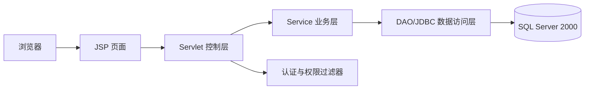
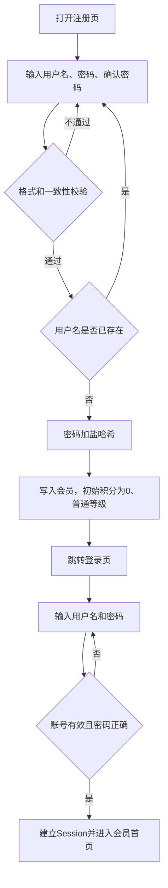
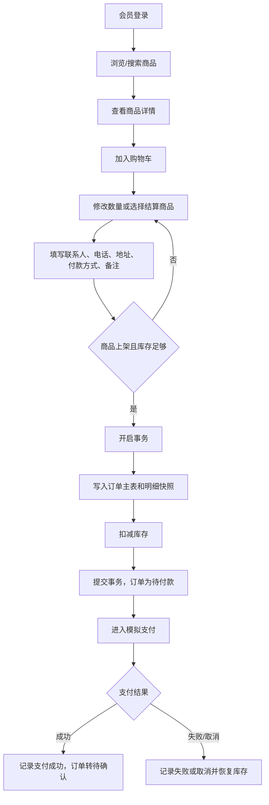
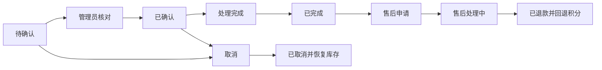
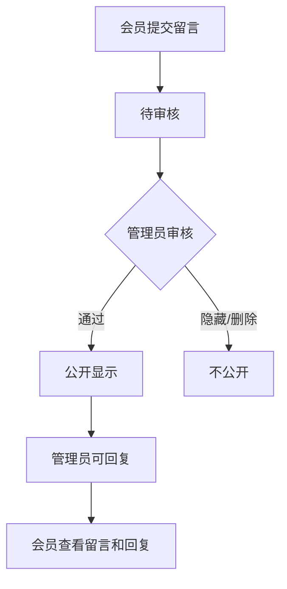
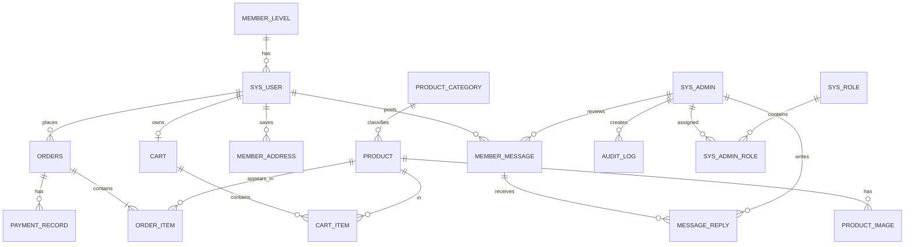

# 基于会员制的购物网站

## 系统需求规格说明书

| 项目 | 内容 |
|---|---|
| 课题编号 | 019 |
| 文档版本 | V1.0 |
| 编制日期 | 2026-11-04 |
| 技术路线 | JSP、Servlet、JDBC、SQL Server 2000 |
| 目标用户 | 会员、普通管理员、超级管理员 |
| 支付方式 | 模拟支付 |

## 1. 引言

### 1.1 编写目的

本文档把课程设计题目中的业务要求转化为可实现、可测试的系统规格，作为数据库设计、页面设计、JSP 编码、测试和验收的共同依据。

### 1.2 项目范围

系统提供会员注册登录、商品浏览和搜索、购物车、订单、模拟支付、积分等级、留言版以及后台管理功能。未登录用户只能进入登录、注册和密码重置提示页面，不能浏览商品、搜索商品或创建订单。

会员注册页面只要求输入用户名、密码和确认密码。用户名采用方案 A，必须唯一并作为登录名。密码遗忘采用方案 B，由管理员在后台重置；系统不提供邮箱或短信自助找回流程。

允许在题目列出的三张基础表之外增加规范化表，以支持多商品订单、购物车、留言、管理员权限和模拟支付。订单中的联系人、联系电话和地址用于保存下单时的联系信息快照。

### 1.3 技术约束

- 数据库使用 SQL Server 2000 兼容的数据类型和 SQL 语法。
- 表现层使用 JSP，控制层使用 Servlet，数据访问使用 JDBC 和 DAO，业务规则集中在 Service 层。
- 所有中文输入输出统一使用 UTF-8 或项目统一选定的中文编码。
- 数据库连接、事务、权限校验和异常处理不得直接散落在 JSP 页面中。

### 1.4 术语

| 术语 | 定义 |
|---|---|
| 会员 | 已注册并通过登录认证的购物用户 |
| 普通管理员 | 可处理用户、商品、订单和留言的后台用户 |
| 超级管理员 | 在普通管理员权限基础上，可维护管理员账号、角色和会员等级规则 |
| 模拟支付 | 在系统内部记录支付成功或失败，不连接第三方支付平台 |
| 订单联系信息 | 下单时保存的联系人、电话和地址；它是订单快照，不随会员资料变化而改变 |

## 2. 总体描述

### 2.1 系统参与者

1. 未登录访客：注册、登录、查看密码重置提示。
2. 会员：完成购物、订单和留言相关操作。
3. 普通管理员：完成日常后台管理。
4. 超级管理员：维护后台账号、角色和会员等级规则。

### 2.2 系统逻辑架构

### 2.3 核心业务约束

- 用户名在 `sys_user` 中唯一；注册时重复用户名必须拒绝。
- 注册时的确认密码只用于页面和服务端校验，不写入数据库。
- 密码只能以应用层加盐哈希值保存，不能保存明文。
- 会员必须登录后才能访问商品、购物车、订单和留言功能。
- 购物车允许多个商品，每种商品可设置购买数量。
- 下单时必须在一个事务中校验商品状态和库存、写入订单及明细并扣减库存。
- 订单明细保存商品名称、单价和积分快照，商品后续修改不影响历史订单。
- 订单完成后累计商品积分；订单取消或退款时回退对应积分。
- 会员只能查询和维护自己的订单、购物车和留言。
- 管理员对会员、商品、订单和留言的操作必须记录操作日志。

## 3. 功能需求

### 3.1 认证与权限

| 编号 | 需求 | 描述 | 优先级 |
|---|---|---|---|
| FR-AUTH-001 | 会员注册 | 输入用户名、密码、确认密码；校验必填、密码一致性和用户名唯一性；成功后创建普通会员 | 高 |
| FR-AUTH-002 | 会员登录 | 使用用户名和密码登录；校验账号状态；成功后建立会员 Session | 高 |
| FR-AUTH-003 | 管理员登录 | 使用独立入口登录；加载管理员角色和权限 | 高 |
| FR-AUTH-004 | 退出登录 | 清理 Session 和购物会话信息 | 高 |
| FR-AUTH-005 | 修改资料 | 会员登录后修改性别、邮箱、联系电话等资料 | 中 |
| FR-AUTH-006 | 修改密码 | 校验旧密码、新密码和确认密码；修改成功后使旧密码失效 | 高 |
| FR-AUTH-007 | 管理员重置密码 | 管理员为会员生成临时密码并标记下次登录必须修改 | 高 |
| FR-AUTH-008 | 访问控制 | 未登录用户访问受保护资源时跳转登录页；越权访问返回无权限页面 | 高 |

### 3.2 商品中心

| 编号 | 需求 | 描述 |
|---|---|---|
| FR-PROD-001 | 商品分类 | 管理员新增、修改、停用和查询商品分类 |
| FR-PROD-002 | 商品维护 | 管理员维护商品编号、名称、库存、价格、分类、介绍、推荐标志、上架日期和商品积分 |
| FR-PROD-003 | 商品图片 | 管理员维护商品主图和附图；会员查看商品图片 |
| FR-PROD-004 | 上下架 | 管理员设置草稿、上架或下架状态；下架商品不可加入购物车 |
| FR-PROD-005 | 商品浏览 | 登录会员查看上架商品列表和详情 |
| FR-PROD-006 | 商品搜索 | 按名称关键字搜索，并支持分类、价格区间、推荐标志和分页 |
| FR-PROD-007 | 库存校验 | 商品库存不得为负；库存不足时禁止加入购物车或提交订单 |

### 3.3 购物车

| 编号 | 需求 | 描述 |
|---|---|---|
| FR-CART-001 | 加入购物车 | 会员从商品详情页加入商品；同一购物车中的同一商品合并数量 |
| FR-CART-002 | 修改数量 | 购物车页面修改购买数量，数量必须为正整数且不超过当前库存 |
| FR-CART-003 | 删除商品 | 删除指定商品或清空购物车 |
| FR-CART-004 | 批量结算 | 选择一个或多个购物车商品进入结算页 |

### 3.4 订单与模拟支付

| 编号 | 需求 | 描述 |
|---|---|---|
| FR-ORD-001 | 创建订单 | 会员提交联系人、电话、地址、付款方式和备注后创建多商品订单 |
| FR-ORD-002 | 订单快照 | 订单明细保存商品名称、单价、数量、积分和小计 |
| FR-ORD-003 | 库存事务 | 创建订单时原子校验并扣减库存；失败则整体回滚 |
| FR-ORD-004 | 模拟支付 | 会员在模拟支付页选择成功或失败；系统保存支付记录和支付状态 |
| FR-ORD-005 | 订单查询 | 会员按订单号、日期和状态查询自己的历史订单，并查看明细 |
| FR-ORD-006 | 订单取消 | 会员可取消符合条件的订单；取消后恢复库存 |
| FR-ORD-007 | 后台处理 | 管理员查询、核对、确认、完成、取消订单，并处理退款状态 |
| FR-ORD-008 | 金额计算 | 订单总金额等于所有明细小计之和；系统不计算独立附加费用 |
| FR-ORD-009 | 未付款订单修改 | 订单尚未付款时，会员可以修改联系人、电话、地址、备注和商品数量；修改数量时重新校验库存 |
| FR-ORD-010 | 售后申请 | 会员可对符合条件的已完成订单提交退款申请；管理员审核后更新售后和支付状态 |

订单状态定义如下：

| 代码 | 状态 | 允许的主要操作 |
|---|---|---|
| W | 待付款 | 会员进入模拟支付或取消 |
| C | 待确认 | 管理员核对订单 |
| P | 已确认 | 管理员处理订单 |
| F | 已完成 | 订单完成并结算积分 |
| X | 已取消 | 释放库存，订单结束 |
| R | 售后处理中 | 管理员处理售后申请 |
| D | 已退款 | 退款完成，回退相应积分 |

支付状态定义如下：`U` 未支付、`P` 已支付、`F` 支付失败、`R` 已退款。

### 3.5 积分与会员等级

系统初始化四个会员等级，积分区间可由超级管理员调整：

| 等级 | 初始积分区间 |
|---|---:|
| 普通会员 | 0—999 |
| 银牌会员 | 1000—4999 |
| 金牌会员 | 5000—9999 |
| 钻石会员 | 10000 及以上 |

订单完成后，系统按订单明细中的商品积分乘以购买数量计算本次获得积分；订单取消或退款时回退积分，并重新计算会员等级。积分默认只用于等级计算，不直接抵扣订单金额。

### 3.6 留言版

| 编号 | 需求 | 描述 |
|---|---|---|
| FR-MSG-001 | 发布留言 | 会员填写标题和正文提交留言，初始状态为待审核 |
| FR-MSG-002 | 审核显示 | 管理员审核通过后公开显示；隐藏或删除的留言不对会员公开 |
| FR-MSG-003 | 查看留言 | 会员查看已审核公开留言和管理员回复 |
| FR-MSG-004 | 维护本人留言 | 会员可修改或删除自己尚未审核的留言 |
| FR-MSG-005 | 管理员回复 | 管理员可回复、隐藏、删除留言，并记录审核人和时间 |

### 3.7 后台管理与统计

- 用户管理：查询会员、查看详情、修改资料、启用/禁用、重置密码、调整积分。
- 商品管理：分类、商品、库存、图片、推荐标志和上下架维护。
- 订单管理：查询、核对、确认、完成、取消、售后和退款状态维护。
- 留言管理：审核、公开、隐藏、删除和回复。
- 会员等级管理：维护等级名称、积分上下限和启用状态。
- 管理员管理：超级管理员新增、修改、禁用管理员账号并分配角色。
- 操作日志：记录关键增删改、状态变更和管理员身份。
- 基础统计：显示会员数、商品数、订单数、留言数和订单金额汇总。

## 4. 角色权限表

| 功能 | 访客 | 会员 | 普通管理员 | 超级管理员 |
|---|---:|---:|---:|---:|
| 注册/登录/退出 | ✓ | ✓ | ✓ | ✓ |
| 浏览和搜索商品 | — | ✓ | ✓ | ✓ |
| 购物车和结算 | — | ✓ | — | — |
| 模拟支付 | — | ✓ | — | — |
| 查询/取消本人订单 | — | ✓ | — | — |
| 查询和处理全部订单 | — | — | ✓ | ✓ |
| 发布和查看公开留言 | — | ✓ | — | — |
| 审核/回复/删除留言 | — | — | ✓ | ✓ |
| 会员资料和密码管理 | — | 本人 | ✓ | ✓ |
| 商品和分类管理 | — | — | ✓ | ✓ |
| 会员等级规则 | — | — | — | ✓ |
| 管理员账号和角色 | — | — | — | ✓ |
| 操作日志和统计 | — | — | 查看统计 | ✓ |

## 5. 功能结构图

```mermaid
flowchart TD
    A[会员制购物网站] --> B[认证与权限]
    A --> C[会员中心]
    A --> D[商品中心]
    A --> E[购物车]
    A --> F[订单与模拟支付]
    A --> G[积分与等级]
    A --> H[留言版]
    A --> I[后台管理]

    B --> B1[会员注册/登录]
    B --> B2[管理员登录]
    B --> B3[Session与权限过滤]
    B --> B4[管理员重置密码]

    C --> C1[资料维护]
    C --> C2[修改密码]
    C --> C3[积分/等级查询]

    D --> D1[分类]
    D --> D2[商品详情]
    D --> D3[关键字搜索]
    D --> D4[推荐与库存]

    E --> E1[加入]
    E --> E2[数量修改]
    E --> E3[删除/清空]
    E --> E4[批量结算]

    F --> F1[创建多商品订单]
    F --> F2[库存事务]
    F --> F3[模拟支付]
    F --> F4[历史订单]
    F --> F5[取消/退款]

    H --> H1[发布]
    H --> H2[审核显示]
    H --> H3[回复]

    I --> I1[用户管理]
    I --> I2[商品管理]
    I --> I3[订单管理]
    I --> I4[留言管理]
    I --> I5[等级/管理员/日志/统计]
```

## 6. 业务流程图

### 6.1 注册和登录流程

### 6.2 购物、下单和模拟支付流程

### 6.3 后台订单流程

### 6.4 留言流程

## 7. 数据库 ER 图

## 8. 完整数据库表结构

以下定义使用 SQL Server 2000 可用的数据类型。`IDENTITY(1,1)` 表示自增主键；所有时间字段使用 `DATETIME`；金额使用 `DECIMAL(18,2)`。

### 8.1 `member_level`：会员等级表

| 字段 | 类型 | 约束/默认值 | 说明 |
|---|---|---|---|
| level_id | INT | PK, IDENTITY | 等级编号 |
| level_name | NVARCHAR(30) | NOT NULL, UNIQUE | 等级名称 |
| min_points | INT | NOT NULL, >=0 | 最低积分 |
| max_points | INT | NULL | 最高积分；钻石等级为空 |
| sort_no | INT | NOT NULL DEFAULT 0 | 显示顺序 |
| status | CHAR(1) | NOT NULL DEFAULT 'A' | A启用，I停用 |

### 8.2 `sys_user`：会员表

| 字段 | 类型 | 约束/默认值 | 说明 |
|---|---|---|---|
| user_id | INT | PK, IDENTITY | 用户编号 |
| username | NVARCHAR(50) | NOT NULL, UNIQUE | 唯一登录名 |
| password_hash | VARCHAR(128) | NOT NULL | 应用层加盐哈希值 |
| must_change_password | BIT | NOT NULL DEFAULT 0 | 管理员重置后强制改密 |
| gender | CHAR(1) | NULL | M男、F女、U未知 |
| email | VARCHAR(100) | NULL | 资料字段，注册后可补充 |
| phone | VARCHAR(20) | NULL | 资料字段，注册后可补充 |
| register_time | DATETIME | NOT NULL DEFAULT GETDATE() | 注册时间 |
| total_points | INT | NOT NULL DEFAULT 0, >=0 | 累计积分 |
| level_id | INT | NOT NULL, FK | 当前等级 |
| account_status | CHAR(1) | NOT NULL DEFAULT 'A' | A启用、I禁用 |
| last_login_time | DATETIME | NULL | 最近登录时间 |

外键：`level_id -> member_level.level_id`。

### 8.3 `sys_admin`：管理员表

| 字段 | 类型 | 约束/默认值 | 说明 |
|---|---|---|---|
| admin_id | INT | PK, IDENTITY | 管理员编号 |
| admin_name | NVARCHAR(50) | NOT NULL, UNIQUE | 管理员登录名 |
| password_hash | VARCHAR(128) | NOT NULL | 加盐哈希值 |
| real_name | NVARCHAR(50) | NULL | 姓名 |
| email | VARCHAR(100) | NULL | 邮箱 |
| phone | VARCHAR(20) | NULL | 联系电话 |
| status | CHAR(1) | NOT NULL DEFAULT 'A' | A启用、I禁用 |
| created_time | DATETIME | NOT NULL DEFAULT GETDATE() | 创建时间 |
| last_login_time | DATETIME | NULL | 最近登录时间 |

### 8.4 `sys_role`：管理员角色表

| 字段 | 类型 | 约束/默认值 | 说明 |
|---|---|---|---|
| role_id | INT | PK, IDENTITY | 角色编号 |
| role_code | VARCHAR(30) | NOT NULL, UNIQUE | 角色代码 |
| role_name | NVARCHAR(50) | NOT NULL | 角色名称 |
| description | NVARCHAR(200) | NULL | 角色说明 |
| status | CHAR(1) | NOT NULL DEFAULT 'A' | A启用、I停用 |

初始化角色：`SUPER_ADMIN`（超级管理员）、`OPER_ADMIN`（普通管理员）。

### 8.5 `sys_admin_role`：管理员角色关联表

| 字段 | 类型 | 约束/默认值 | 说明 |
|---|---|---|---|
| admin_id | INT | PK/FK | 管理员编号 |
| role_id | INT | PK/FK | 角色编号 |

联合主键：`(admin_id, role_id)`。

### 8.6 `product_category`：商品分类表

| 字段 | 类型 | 约束/默认值 | 说明 |
|---|---|---|---|
| category_id | INT | PK, IDENTITY | 分类编号 |
| category_name | NVARCHAR(50) | NOT NULL, UNIQUE | 分类名称 |
| description | NVARCHAR(200) | NULL | 分类说明 |
| sort_no | INT | NOT NULL DEFAULT 0 | 显示顺序 |
| status | CHAR(1) | NOT NULL DEFAULT 'A' | A启用、I停用 |
| created_time | DATETIME | NOT NULL DEFAULT GETDATE() | 创建时间 |

### 8.7 `product`：商品表

| 字段 | 类型 | 约束/默认值 | 说明 |
|---|---|---|---|
| product_id | INT | PK, IDENTITY | 商品内部编号 |
| product_code | VARCHAR(30) | NOT NULL, UNIQUE | 商品编号 |
| product_name | NVARCHAR(100) | NOT NULL | 商品名称 |
| category_id | INT | NOT NULL, FK | 所属分类 |
| stock_qty | INT | NOT NULL DEFAULT 0, >=0 | 库存数量 |
| unit_price | DECIMAL(18,2) | NOT NULL, >=0 | 商品单价 |
| product_intro | NVARCHAR(2000) | NULL | 商品介绍 |
| recommend_flag | BIT | NOT NULL DEFAULT 0 | 是否推荐 |
| listing_date | DATETIME | NULL | 上架时间 |
| product_points | INT | NOT NULL DEFAULT 0, >=0 | 单件商品积分 |
| product_status | CHAR(1) | NOT NULL DEFAULT 'D' | D草稿、O上架、X下架 |
| main_image_url | NVARCHAR(255) | NULL | 主图地址 |
| created_time | DATETIME | NOT NULL DEFAULT GETDATE() | 创建时间 |
| updated_time | DATETIME | NULL | 修改时间 |

外键：`category_id -> product_category.category_id`。

### 8.8 `product_image`：商品图片表

| 字段 | 类型 | 约束/默认值 | 说明 |
|---|---|---|---|
| image_id | INT | PK, IDENTITY | 图片编号 |
| product_id | INT | NOT NULL, FK | 商品编号 |
| image_url | NVARCHAR(255) | NOT NULL | 图片地址 |
| is_main | BIT | NOT NULL DEFAULT 0 | 是否主图 |
| sort_no | INT | NOT NULL DEFAULT 0 | 显示顺序 |
| created_time | DATETIME | NOT NULL DEFAULT GETDATE() | 创建时间 |

### 8.9 `cart`：购物车表

| 字段 | 类型 | 约束/默认值 | 说明 |
|---|---|---|---|
| cart_id | INT | PK, IDENTITY | 购物车编号 |
| user_id | INT | NOT NULL, UNIQUE, FK | 所属会员，每人一辆活动购物车 |
| created_time | DATETIME | NOT NULL DEFAULT GETDATE() | 创建时间 |
| updated_time | DATETIME | NULL | 修改时间 |

### 8.10 `cart_item`：购物车明细表

| 字段 | 类型 | 约束/默认值 | 说明 |
|---|---|---|---|
| cart_item_id | INT | PK, IDENTITY | 明细编号 |
| cart_id | INT | NOT NULL, FK | 购物车编号 |
| product_id | INT | NOT NULL, FK | 商品编号 |
| quantity | INT | NOT NULL, >0 | 购买数量 |
| add_time | DATETIME | NOT NULL DEFAULT GETDATE() | 加入时间 |
| updated_time | DATETIME | NULL | 修改时间 |

唯一约束：`(cart_id, product_id)`。

### 8.11 `member_address`：会员地址簿

| 字段 | 类型 | 约束/默认值 | 说明 |
|---|---|---|---|
| address_id | INT | PK, IDENTITY | 地址编号 |
| user_id | INT | NOT NULL, FK | 所属会员 |
| receiver_name | NVARCHAR(50) | NOT NULL | 联系人 |
| receiver_phone | VARCHAR(20) | NOT NULL | 联系电话 |
| address_detail | NVARCHAR(255) | NOT NULL | 地址内容 |
| is_default | BIT | NOT NULL DEFAULT 0 | 是否默认 |
| created_time | DATETIME | NOT NULL DEFAULT GETDATE() | 创建时间 |
| updated_time | DATETIME | NULL | 修改时间 |

该表仅用于会员下单时复用联系信息；订单创建后必须复制联系人、电话和地址到订单表。

### 8.12 `orders`：订单主表

| 字段 | 类型 | 约束/默认值 | 说明 |
|---|---|---|---|
| order_id | INT | PK, IDENTITY | 内部订单编号 |
| order_no | VARCHAR(32) | NOT NULL, UNIQUE | 对外订单号 |
| user_id | INT | NOT NULL, FK | 下单会员 |
| order_time | DATETIME | NOT NULL DEFAULT GETDATE() | 下单时间 |
| receiver_name | NVARCHAR(50) | NOT NULL | 订单联系人快照 |
| receiver_phone | VARCHAR(20) | NOT NULL | 联系电话快照 |
| receiver_address | NVARCHAR(255) | NOT NULL | 地址快照 |
| payment_method | VARCHAR(30) | NOT NULL DEFAULT 'SIMULATED_ONLINE' | 模拟在线支付或模拟余额支付 |
| payment_status | CHAR(1) | NOT NULL DEFAULT 'U' | U未支付、P已支付、F失败、R已退款 |
| order_status | CHAR(1) | NOT NULL DEFAULT 'W' | W待付款、C待确认、P已确认、F已完成、X已取消、R售后处理中、D已退款 |
| total_amount | DECIMAL(18,2) | NOT NULL, >=0 | 订单总金额 |
| earned_points | INT | NOT NULL DEFAULT 0, >=0 | 本单结算积分 |
| remark | NVARCHAR(500) | NULL | 会员备注 |
| cancel_reason | NVARCHAR(200) | NULL | 取消原因 |
| refund_reason | NVARCHAR(200) | NULL | 售后或退款原因 |
| refund_time | DATETIME | NULL | 退款完成时间 |
| completed_time | DATETIME | NULL | 完成时间 |
| updated_time | DATETIME | NULL | 修改时间 |

### 8.13 `order_item`：订单明细表

| 字段 | 类型 | 约束/默认值 | 说明 |
|---|---|---|---|
| order_item_id | INT | PK, IDENTITY | 明细编号 |
| order_id | INT | NOT NULL, FK | 订单编号 |
| product_id | INT | NOT NULL, FK | 商品编号 |
| product_name_snapshot | NVARCHAR(100) | NOT NULL | 商品名称快照 |
| unit_price | DECIMAL(18,2) | NOT NULL, >=0 | 成交单价 |
| quantity | INT | NOT NULL, >0 | 购买数量 |
| item_points | INT | NOT NULL DEFAULT 0, >=0 | 单件积分快照 |
| subtotal | DECIMAL(18,2) | NOT NULL, >=0 | 明细小计 |

唯一约束：`(order_id, product_id)`。

### 8.14 `payment_record`：模拟支付记录表

| 字段 | 类型 | 约束/默认值 | 说明 |
|---|---|---|---|
| payment_id | INT | PK, IDENTITY | 支付记录编号 |
| order_id | INT | NOT NULL, FK | 订单编号 |
| payment_no | VARCHAR(40) | NOT NULL, UNIQUE | 支付流水号 |
| payment_method | VARCHAR(30) | NOT NULL DEFAULT 'SIMULATED_ONLINE' | SIMULATED_ONLINE或SIMULATED_BALANCE |
| payment_amount | DECIMAL(18,2) | NOT NULL, >=0 | 支付金额 |
| payment_status | CHAR(1) | NOT NULL DEFAULT 'U' | U未支付、S成功、F失败、R退款 |
| paid_time | DATETIME | NULL | 成功时间 |
| transaction_reference | VARCHAR(64) | NULL | 模拟交易参考号 |
| created_time | DATETIME | NOT NULL DEFAULT GETDATE() | 创建时间 |

### 8.15 `member_message`：留言表

| 字段 | 类型 | 约束/默认值 | 说明 |
|---|---|---|---|
| message_id | INT | PK, IDENTITY | 留言编号 |
| user_id | INT | NOT NULL, FK | 发布会员 |
| title | NVARCHAR(100) | NOT NULL | 留言标题 |
| content | NVARCHAR(2000) | NOT NULL | 留言正文 |
| message_status | CHAR(1) | NOT NULL DEFAULT 'P' | P待审核、A已显示、H隐藏、D删除 |
| created_time | DATETIME | NOT NULL DEFAULT GETDATE() | 发布时间 |
| updated_time | DATETIME | NULL | 修改时间 |
| reviewer_admin_id | INT | NULL, FK | 审核管理员 |
| review_time | DATETIME | NULL | 审核时间 |

### 8.16 `message_reply`：留言回复表

| 字段 | 类型 | 约束/默认值 | 说明 |
|---|---|---|---|
| reply_id | INT | PK, IDENTITY | 回复编号 |
| message_id | INT | NOT NULL, FK | 留言编号 |
| admin_id | INT | NOT NULL, FK | 回复管理员 |
| content | NVARCHAR(2000) | NOT NULL | 回复内容 |
| created_time | DATETIME | NOT NULL DEFAULT GETDATE() | 回复时间 |

### 8.17 `audit_log`：操作日志表

| 字段 | 类型 | 约束/默认值 | 说明 |
|---|---|---|---|
| log_id | INT | PK, IDENTITY | 日志编号 |
| admin_id | INT | NULL, FK | 操作管理员 |
| operation_type | VARCHAR(50) | NOT NULL | 操作类型 |
| target_type | VARCHAR(50) | NOT NULL | 目标类型 |
| target_id | VARCHAR(50) | NULL | 目标编号 |
| operation_detail | NVARCHAR(500) | NULL | 操作说明 |
| operation_time | DATETIME | NOT NULL DEFAULT GETDATE() | 操作时间 |
| ip_address | VARCHAR(45) | NULL | 来源地址 |

### 8.18 外键关系和索引要求

- `sys_user.level_id -> member_level.level_id`。
- `product.category_id -> product_category.category_id`。
- `product_image.product_id -> product.product_id`。
- `cart.user_id -> sys_user.user_id`；`cart_item.cart_id -> cart.cart_id`；`cart_item.product_id -> product.product_id`。
- `member_address.user_id -> sys_user.user_id`。
- `orders.user_id -> sys_user.user_id`；`order_item.order_id -> orders.order_id`；`order_item.product_id -> product.product_id`。
- `payment_record.order_id -> orders.order_id`。
- `member_message.user_id -> sys_user.user_id`；`member_message.reviewer_admin_id -> sys_admin.admin_id`；`message_reply.message_id -> member_message.message_id`；`message_reply.admin_id -> sys_admin.admin_id`。
- `sys_admin_role.admin_id -> sys_admin.admin_id`；`sys_admin_role.role_id -> sys_role.role_id`；`audit_log.admin_id -> sys_admin.admin_id`。
- 为 `username`、`admin_name`、`product_code`、`order_no`、`payment_no` 建唯一索引。
- 为 `product_status`、`category_id`、`order_status`、`payment_status`、`user_id` 和时间字段建立常用查询索引。
- 不对会员、商品和订单做级联物理删除；历史相关数据使用禁用、下架或状态变更保存。

## 9. 页面和菜单清单

### 9.1 公共页面

| 页面 | 用途 | 访问权限 |
|---|---|---|
| `member-login.jsp` | 会员登录 | 访客 |
| `member-register.jsp` | 会员注册 | 访客 |
| `admin-login.jsp` | 管理员登录 | 访客 |
| `reset-help.jsp` | 提示联系管理员重置密码 | 访客/会员 |
| `access-denied.jsp` | 无权限提示 | 全部 |

### 9.2 会员菜单

| 菜单 | 页面 |
|---|---|
| 会员首页 | `member-home.jsp` |
| 商品浏览 | `product-list.jsp`、`product-search.jsp`、`product-detail.jsp` |
| 购物车 | `cart.jsp` |
| 订单结算 | `checkout.jsp`、`payment-simulate.jsp` |
| 我的订单 | `order-list.jsp`、`order-detail.jsp` |
| 我的留言 | `message-list.jsp`、`message-edit.jsp` |
| 个人资料 | `member-profile.jsp` |
| 修改密码 | `change-password.jsp` |
| 退出登录 | `LogoutServlet` |

### 9.3 管理员菜单

| 菜单 | 页面 |
|---|---|
| 控制台 | `admin-home.jsp`、`statistics.jsp` |
| 用户管理 | `user-list.jsp`、`user-detail.jsp`、`user-edit.jsp` |
| 商品管理 | `product-list.jsp`、`product-detail.jsp`、`product-edit.jsp`、`product-image.jsp` |
| 分类管理 | `category-list.jsp`、`category-edit.jsp` |
| 订单管理 | `order-list.jsp`、`order-detail.jsp`、`payment-record.jsp` |
| 留言管理 | `message-list.jsp`、`message-detail.jsp`、`message-reply.jsp` |
| 等级管理 | `level-rule.jsp` |
| 管理员和角色 | `admin-list.jsp`、`admin-edit.jsp`、`role-list.jsp` |
| 操作日志 | `operation-log.jsp` |
| 退出登录 | `AdminLogoutServlet` |

## 10. JSP 系统实现任务分解

### 阶段 1：工程和环境

- 建立 JSP/Servlet Web 工程目录和 MVC 分层目录。
- 配置 Tomcat、JDK、JDBC 驱动和 SQL Server 2000 连接参数。
- 统一字符集、页面布局、异常页面和基础日志。

### 阶段 2：数据库和初始化

- 创建 17 张业务表、主键、外键、唯一约束和查询索引。
- 初始化管理员角色、超级管理员账号和四级会员等级。
- 编写数据库连接、事务和连接释放工具。

### 阶段 3：基础代码框架

- 编写实体类、DAO 接口及 JDBC 实现。
- 编写 Service 层和统一分页、查询条件对象。
- 编写统一返回、异常处理和表单校验组件。

### 阶段 4：认证和权限

- 完成会员注册、登录、退出、资料维护和修改密码。
- 完成管理员独立登录和角色加载。
- 编写登录过滤器、权限过滤器和 Session 超时处理。
- 完成管理员重置密码及首次登录强制修改。

### 阶段 5：商品和分类

- 完成分类、商品、库存、推荐和上下架的 CRUD。
- 完成图片上传地址保存和图片列表维护。
- 完成会员端搜索、筛选、排序、分页和详情页面。

### 阶段 6：购物车

- 完成购物车创建、加入、数量修改、删除和清空。
- 校验商品上架状态、库存和会员归属。
- 完成批量选择结算。

### 阶段 7：订单和模拟支付

- 完成订单主表、明细表和支付记录 DAO/Service。
- 使用事务实现库存校验、扣减和订单写入。
- 完成模拟支付成功、失败和取消分支。
- 完成订单状态流转、历史查询、取消、售后和退款处理。

### 阶段 8：积分和等级

- 编写订单完成积分结算和取消/退款回退逻辑。
- 编写按积分区间刷新等级的服务。
- 完成等级规则后台维护和会员积分展示。

### 阶段 9：留言版和后台

- 完成留言发布、编辑、删除、审核和公开展示。
- 完成管理员回复、隐藏和删除。
- 完成用户、订单、商品、管理员、日志和基础统计页面。

### 阶段 10：安全、测试和交付

- 所有数据库操作使用 `PreparedStatement`，防止 SQL 注入。
- 对输出内容进行 HTML 转义，防止存储型 XSS。
- 防止重复提交、越权访问和非法状态跳转。
- 编写功能测试、权限测试、事务测试和异常测试。
- 编写部署说明、初始化脚本、用户操作说明和课程设计报告。

## 11. 非功能需求

### 11.1 安全性

- 密码使用应用层加盐哈希，日志中不得记录密码。
- 会员和管理员 Session 分离，所有受保护 Servlet 进行服务端权限校验。
- 会员只能读取自己的订单、购物车、资料和留言。
- 所有管理员关键操作写入 `audit_log`。

### 11.2 数据一致性

- 创建订单、扣减库存和写入订单明细必须使用同一事务。
- 库存更新必须带条件校验，禁止出现负库存。
- 订单状态、付款状态和积分结算操作必须校验前置状态。
- 删除操作优先使用状态变更，避免破坏订单历史。

### 11.3 可用性和可维护性

- 页面提供明确的必填提示、错误提示和成功提示。
- 列表页面支持分页，详情页面提供返回入口。
- JSP 不直接编写复杂 SQL；业务逻辑集中在 Service 层。
- 数据库字段、状态代码和角色代码统一维护，避免页面硬编码不一致。

## 12. 验收标准

1. 重复用户名注册失败；正确注册后可以使用用户名和密码登录。
2. 未登录访问商品、购物车或订单地址时被拦截。
3. 会员可以完成多商品购物车结算并生成一张包含多条明细的订单。
4. 库存不足不能下单；订单取消后库存恢复；并发提交不会产生负库存。
5. 模拟支付成功后订单进入待确认，失败或取消后订单不保留占用库存。
6. 管理员可以核对、确认、完成、取消和处理退款订单。
7. 订单完成增加积分，取消或退款按规则回退积分并刷新等级。
8. 会员留言经过管理员审核后才公开，管理员可以回复和删除。
9. 普通管理员不能维护管理员账号、角色和会员等级规则；超级管理员可以维护。
10. 管理员重置密码后，会员首次登录必须修改临时密码。
11. 数据库表、外键、唯一约束和索引符合第 8 节定义。
12. 系统的订单、页面和数据库只实现本文档定义的订单处理范围，不增加其他履约管理功能。

## 13. 交付物

- JSP/Servlet/JDBC 源代码。
- SQL Server 2000 建库和初始化脚本。
- 系统需求规格说明书（本文档）。
- 数据库 ER 图和表结构说明。
- 页面截图及操作说明。
- 测试用例、测试结果和部署说明。
